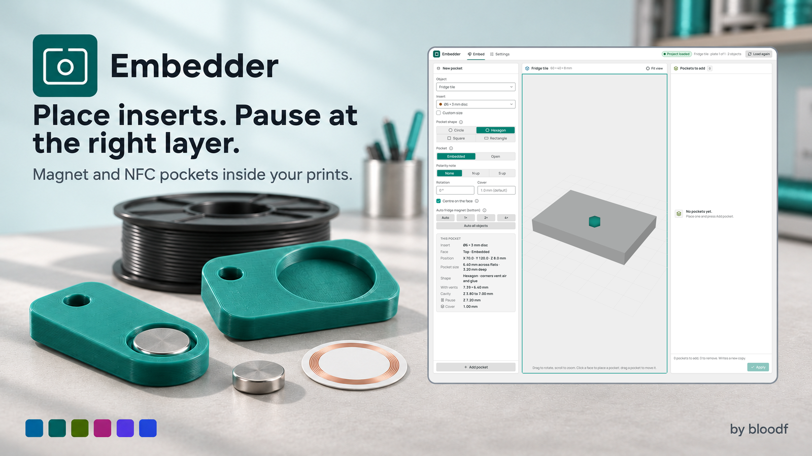
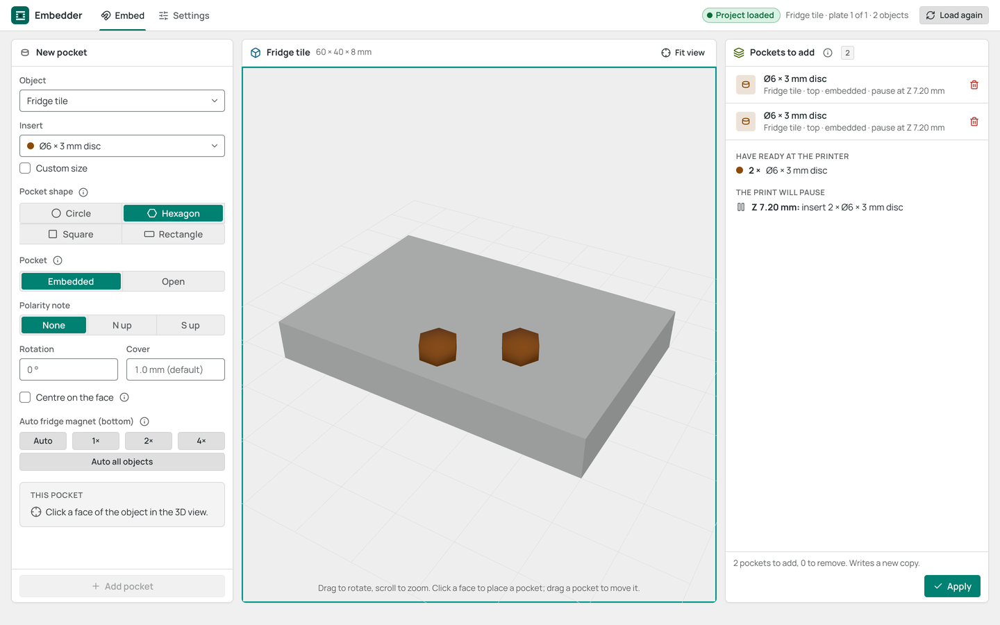
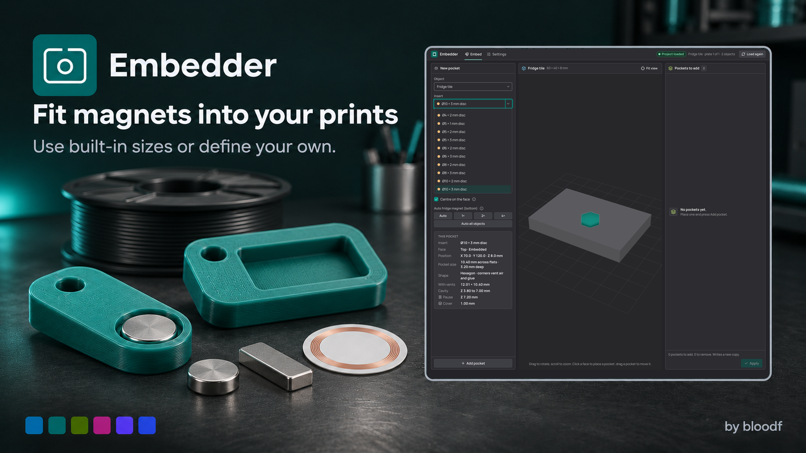
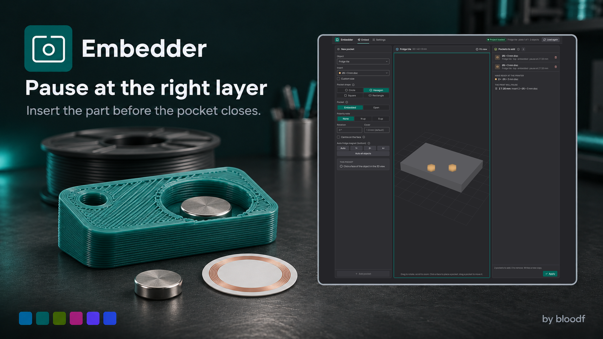
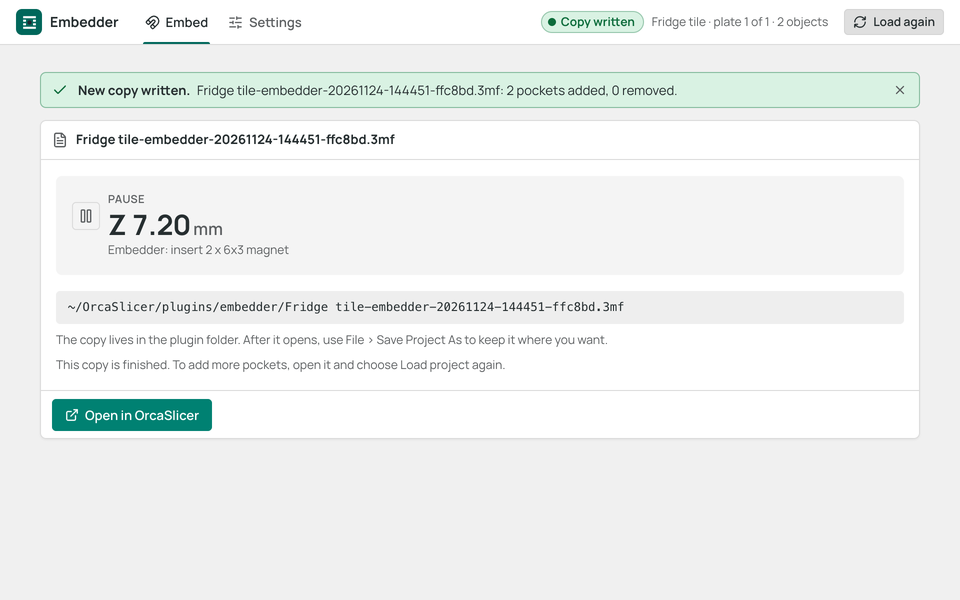

  <picture>
    <source media="(prefers-color-scheme: dark)" srcset="assets/readme/embedder-hero-dark-en.png">
    
  </picture>

<h1 align="center">🧲 Embedder</h1>

<b>Magnet and NFC pockets, with the pause at the right layer.</b> An OrcaSlicer plugin · by bloodf

  
  
  
  

  <a href="#-install">Install</a> · <a href="#-features">Features</a> · <a href="#-how-to-use">How to use</a> · <a href="#-faq">FAQ</a> · <a href="README.pt-BR.md">Português</a>

## ✨ What it does

Embedder puts magnets, NFC stickers and nuts inside your 3D prints. You pick an insert size and click the face of the part where it goes, and Embedder cuts a pocket with the right clearance. For a pocket that is sealed inside the print, it also adds a pause at the layer where the cavity is about to close, so you can drop the insert in before the printer covers it. It works on a copy of your project, and the original is never changed.

  <picture>
    <source media="(prefers-color-scheme: dark)" srcset="assets/readme/embedder-screen-pockets-dark-en.png">
    
  </picture>

## 📦 Install

First find OrcaSlicer's **Plugins** window:

- **Windows and Linux:** click the small ▾ arrow right of **File** at the top-left corner of the OrcaSlicer window, then **Plugins**. (**Plugins** is not inside **File** here.)
- **macOS:** click **File** in the menu bar at the top of the screen, then **Plugins**.

From Orca Cloud: subscribe to [Embedder on Orca Cloud](https://cloud.orcaslicer.com/p/58222d4f9e52), then open **Plugins**, click **Refresh** and tick **Activate**.

From a file:

1. Download `embedder_any.whl` from the [latest release](https://github.com/bloodf/embedder/releases/latest).
2. Open **Plugins** as above, click the small arrow on the left end of the **Install plugin** button and choose **Install local plugin**, then click it and pick the wheel.
3. Tick **Activate** and allow the background thread when OrcaSlicer asks.
4. Open the **Embedder** tab, next to Prepare, Preview and Device.

Embedder is an independent project, not made or supported by the OrcaSlicer team. Credits for the code and fonts it builds on are in [NOTICE.md](NOTICE.md).

| Requirement | Detail |
|---|---|
| OrcaSlicer | 2.5.0 or newer |
| Printer profile | A pause G-code (`machine_pause_gcode`) for embedded pockets. Most profiles have one. Open pockets need none. |
| Python packages | None |
| Network | None |

## 🧰 Features

<table>
  <tr>
    <td width="50%" valign="top">
      
      
<b>Click where it goes</b> Rotate the part in the 3D view and click a face. The pocket shows there before anything is written.

    </td>
    <td width="50%" valign="top">
      
      
<b>Magnet sizes built in</b> 15 disc magnets from 3x1 to 20x3 mm and 4 block magnets, with clearance you can tune for your printer.

    </td>
  </tr>
  <tr>
    <td width="50%" valign="top">
      
      
<b>NFC stickers too</b> 7 round stickers from 10 to 38 mm, 2 coin tags and a card, under a 0.6 mm cover by default.

    </td>
    <td width="50%" valign="top">
      
      
<b>Pause at the right layer</b> OrcaSlicer's own layer pause, on the first layer above the cavity. You see it on the layer slider.

    </td>
  </tr>
</table>

| | Feature | What you get |
|---|---|---|
| | Embedded pockets | A cavity sealed under a cover (1.0 mm for magnets, 0.6 mm for NFC by default) on flat faces and upright side faces. The print pauses one layer before the cavity closes. |
| | Open pockets | A pocket cut into any face, tilted ones included, for press-fit after printing. No pause. |
| | Vented shapes | A disc sits in a hexagon and a block in a box with a 1 mm round vent on each corner. Air and spare glue get out, so the insert goes all the way down. |
| | Pick the shape | Circle, hexagon, square or rectangle, each the smallest that holds the insert. Your pick is kept for its preset. |
| | Side-face slots | Behind an upright wall the insert stands on edge in a vertical slot and is dropped in from above. |
| | Auto fridge magnet | **Auto fridge magnet (bottom)** (`Auto`, `1×`, `2×`, `4×`) finds the bottom of the selected object and stages symmetric magnet pockets there, away from the edge. **Auto all objects** does it for every object on the plate in one click. |
| | Polarity note | Mark a magnet pocket "N up" or "S up". The note shows in the pocket list and in the pause message, so each magnet goes in the right way round. |
| | Centre on the face | Puts the pocket in the middle of the flat face you click, which is what a lid, a base or a tile needs. |
| | Your own sizes | Any disc, block or nut, saved by name and kept between sessions. |
| | Inserts to have ready | Under the pocket list, for example "2 x 6x3 magnet, 1 x 25 mm NFC sticker", with the heights where the print will pause. Every copy of an object counts. |
| | Shared pauses | Pockets that end at the same height share one pause. |
| | Warnings while you place | A thin cover, a pocket that reaches outside the part, an NFC tag within 10 mm of a magnet, or your own custom G-code already on the pause layer. |
| | Safe copy | **Apply** writes a new project file and opens it. Your project is never written. |
| | Remove or re-apply | Pockets and pauses Embedder made are marked. Load the project again and they are listed, ready to remove. |
| | Tidy storage | After each **Apply**, copies beyond the 10 most recent or older than 30 days are deleted. |

Built-in sizes, in mm:

| Insert | Sizes |
|---|---|
| Disc magnets, diameter x thickness | 3x1, 4x2, 5x1, 5x2, 5x3, 6x2, 6x3, 8x2, 8x3, 10x2, 10x3, 10x5, 12x3, 15x3, 20x3 |
| Block magnets, length x width x thickness | 10x5x2, 10x5x3, 20x10x2, 20x10x5 |
| Round NFC stickers, diameter (0.4 mm deep) | 10, 13, 20, 22, 25, 30, 38 |
| NFC coins | 25x1, 30x2 |
| NFC card | 85.6 x 54 x 0.9 |
| Hex nuts, across flats x thickness (hexagon pocket) | M3 5.5x2.4, M4 7x3.2, M5 8x4, M6 10x5 |
| Square nuts, side x thickness | M3 5.5x2.4, M4 7x3.2, M5 8x4 |

The full rules for pocket shapes, the pause, warnings and limits are in [docs/pockets.md](docs/pockets.md).

## 🛠️ How to use

1. Open your project in OrcaSlicer and pick the plate with the part.
2. Open the **Embedder** tab and press **Load project**.
3. Under **Insert**, choose a size from the list, or tick **Custom size** and enter your own. Under **Pocket**, choose **Embedded** or **Open**.
4. Rotate the part and click the face where the insert goes. Tick **Centre on the face** to put it in the middle. **This pocket** shows its size, cavity, pause and cover.
5. Press **Add pocket**. Add more the same way.
6. Press **Apply**, then **Open in OrcaSlicer**. In the new project, use **File > Save Project As** to keep it.
7. Slice. In the preview, the pause shows on the layer slider just above each embedded pocket.
8. Start the print. When it pauses, put the insert in and resume.

  <picture>
    <source media="(prefers-color-scheme: dark)" srcset="assets/readme/embedder-screen-applied-dark-en.png">
    
  </picture>

To move a pocket, drag it in the 3D view: it slides over the surface and turns to the face under it. Click a pocket, or its row under **Pockets to add**, to select it. The form then changes that pocket in place (size, type, rotation, cover), the arrow keys step it 0.5 mm along its face (5 mm with Shift), R turns it 15°, and Delete removes it. A pocket that an earlier Apply already wrote stays where it is: tick it for removal and place it again.

One **Apply** per load: to change the pockets later, open the new project, press **Load project** again and re-apply.

## 🔒 Privacy and safety

| | What and where |
|---|---|
| Reads | The copy of the current plate that OrcaSlicer exports into the plugin's storage folder, and six values of the active profile: layer height, first layer height, pause G-code, print sequence, raft layers and printable area. |
| Writes | New `.3mf` copies and `settings.json`, both in its own storage folder. Never the project you opened. |
| Sends | Nothing. Embedder does not use the network and has no cloud service or telemetry. |
| Printer | No commands. The pause is OrcaSlicer's own layer pause, which runs your profile's pause G-code. Embedder never picks M600 or any other command itself. |

An applied copy contains your whole project, so treat it like the original. A magnet can snap to a steel nozzle or the print head: put it in with the right side up and look before you resume. More in [SECURITY.md](SECURITY.md).

## ❓ FAQ

Why does Apply open a new project instead of changing mine?

OrcaSlicer 2.5 plugins cannot read or change the geometry of the open project, and they cannot draw in OrcaSlicer's 3D view. So Embedder asks OrcaSlicer to export a copy of the current plate, adds each pocket as a negative part and each pause to a new file next to it, and asks OrcaSlicer to open that file. Use **File > Save Project As** to keep it.

Embedded is off for my plate. Why?

Embedder shows the reason. Embedded pockets are blocked when the print sequence is "By object" (OrcaSlicer ignores layer pauses then), the printer profile has no pause G-code, the project prints a raft, the object has a variable or per-range layer height, copies of the object sit on another plate, or the face is tilted. They are also refused when the pocket would reach below the bed, would have no printed layer under it, or the pause would come before the second layer. Open pockets still work.

The print did not pause.

Check three things. The print sequence must be "By layer". The printer profile must have a pause G-code. And if you changed the layer height after Apply, the layers moved: load the new project again and re-apply. When your own custom G-code already sits on the pause layer, Embedder leaves it alone and adds no pause there; it warns you as soon as you place the pocket.

Why is the pocket a hexagon?

A hexagon is as wide across the flats as a round pocket would be, so the six flats hold the disc and the six corners stay open for air and spare glue. A block gets a box with a 1 mm round vent on each corner for the same reason. The tab shows both sizes: the fit, and how wide the pocket is with its corners or vents. A pocket added by a version before 0.3.0 keeps its shape until you remove it and add it again. Want a round hole, a square or a rectangle instead? Pick it under **Pocket shape**.

Can I change the pockets after Apply?

Yes, on the new copy. Open it, press **Load project** again, and Embedder lists the pockets and pauses it made (their names start with "Embedder"), so you can tick them for removal and add new ones. Pockets and pauses you made by hand are left alone.

My object has several copies. Does each one get a pocket?

Yes. One negative part cuts every copy, and the list of inserts counts each one. When the copies differ by more than a Z rotation and a move, no pocket is offered at all.

Apply stopped with "object not found where expected".

That was a bug with projects saved by OrcaSlicer 2.5.1, fixed in Embedder 0.2.1. Update the plugin.

Embedder says my project has no part list.

Cut objects with connectors, bare mesh objects without a parts list, and hand-made 3MF files without OrcaSlicer's part list (`model_settings.config`) are not supported. Embedder says so when you click, before anything is written. Saving the project from OrcaSlicer once adds the part list.

Where do the copies go, and do they pile up?

Each Apply writes a new copy into the plugin's storage folder. Embedder always keeps the newest copy of each project and every copy written since OrcaSlicer started, since OrcaSlicer may have those open. After each Apply it deletes older copies beyond the 10 most recent, and any older than 30 days. **Settings > Old project copies** shows how many can go and how much space they take, and **Clear old copies** deletes them at once, after asking. Files you put in the folder yourself are never touched.

On Linux, Open in OrcaSlicer starts a second window.

On Linux the button starts the OrcaSlicer executable (or the AppImage) with the file, which may open a second window instead of reusing the running one. Close the old window, or open the file from **File > Open Project**.

My NFC tag does not read.

A magnet close to a tag can stop it from reading. Embedder warns when an NFC pocket is within 10 mm of a magnet pocket. A cover thinner than two layers also gets a warning, because the insert may show through.

## 🌍 Languages

English, Brazilian Portuguese, Spanish, German, Simplified Chinese and Polish. Embedder follows OrcaSlicer's language, or the one you pick under **Settings > Language**.

## 🧩 More plugins by bloodf

| | Plugin | What it does | |
|:-:|---|---|---|
|  | 🧩 [Organizer](https://github.com/bloodf/orca_organizer) | Arrange parts by their real outline and fill a plate with more copies. | [Install](https://cloud.orcaslicer.com/p/5bf381fd42d4) |
|  | 🧲 **Embedder** · you are here | Magnet and NFC pockets, with the pause at the right layer. | |
|  | 💰 [Print Calculator](https://github.com/bloodf/orca_print_calculator) | Price every plate: filament, energy, labour, fees and margin. | [Install](https://cloud.orcaslicer.com/p/521c07cf6de2) |
|  | 🧵 [Spooler](https://github.com/bloodf/spooler) | Your Spoolman stock inside OrcaSlicer, with what is left on each spool. | [Install](https://cloud.orcaslicer.com/p/50c35dcbd6f3) |
|  | 🟣 [Kobra Control](https://github.com/bloodf/kobracontrol) | Run the Anycubic Kobra X from OrcaSlicer over your LAN. | [Install](https://cloud.orcaslicer.com/p/59c786285255) |
|  | 🔵 [U1 Control](https://github.com/bloodf/u1control) | Run the Snapmaker U1 from OrcaSlicer: toolheads, camera, files. | [Install](https://cloud.orcaslicer.com/p/55b8c347d443) |

Each plugin works on its own; installed together they share data where it helps.

## 🤝 Contributing

Bug reports, projects that fail to load and pull requests are welcome: start with [CONTRIBUTING.md](CONTRIBUTING.md) and open an [issue](https://github.com/bloodf/embedder/issues). The developer material is in [docs/](docs): [pockets, pauses and limits](docs/pockets.md), [architecture](docs/architecture.md), [3MF notes](docs/3mf.md), [releasing](docs/release.md) and the [Orca Cloud description](docs/orca-cloud-description.md). See also the [changelog](CHANGELOG.md), the [code of conduct](CODE_OF_CONDUCT.md) and [SECURITY.md](SECURITY.md).

## 📄 License

GPL-3.0-only. See [LICENSE](LICENSE).

by bloodf

