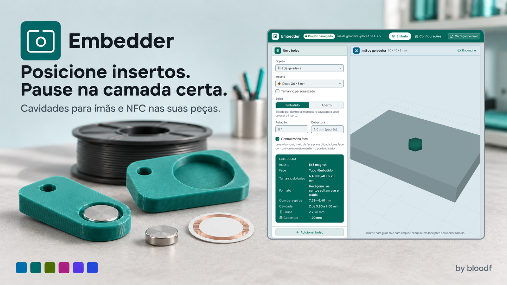
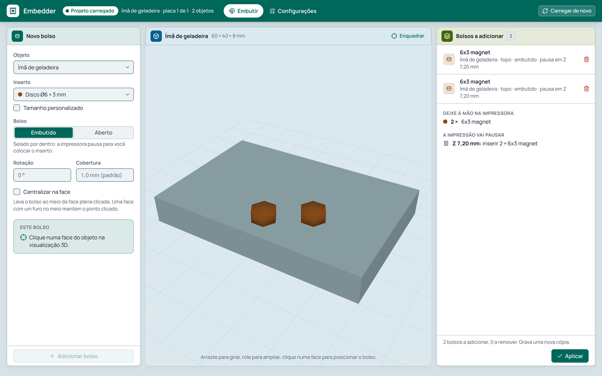
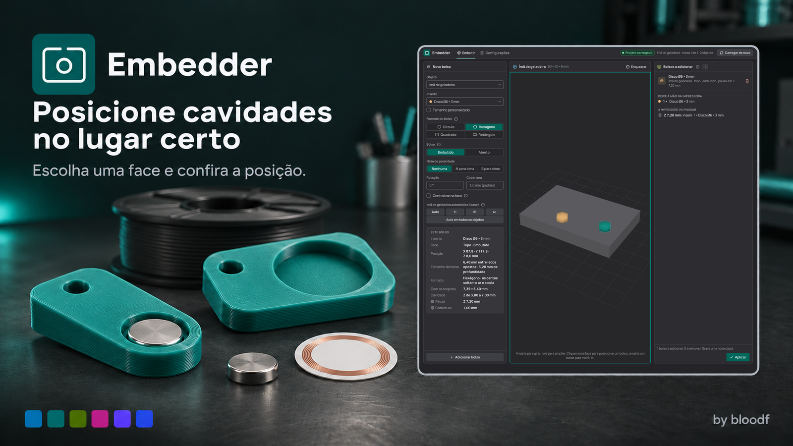
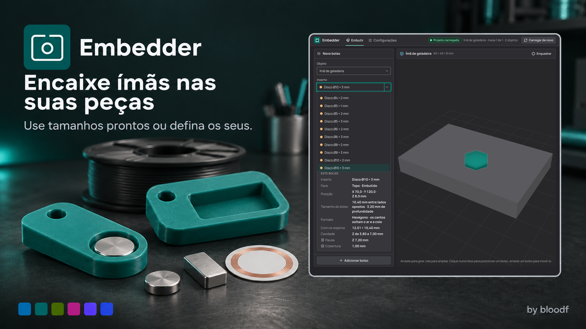
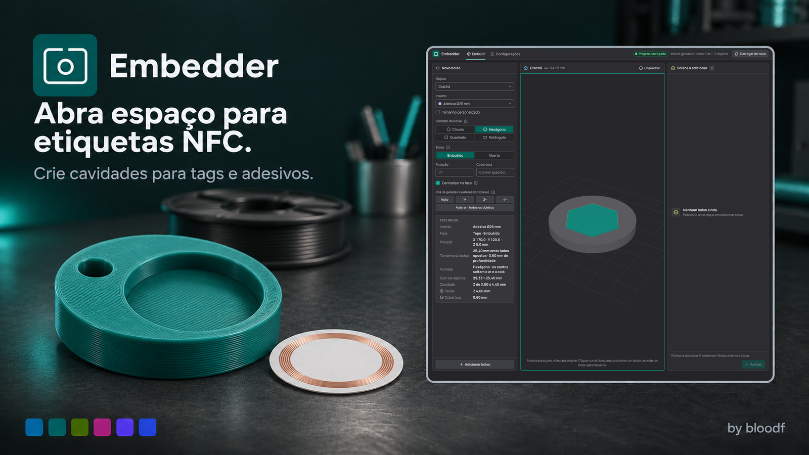
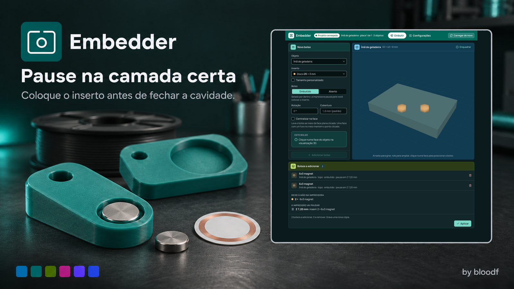
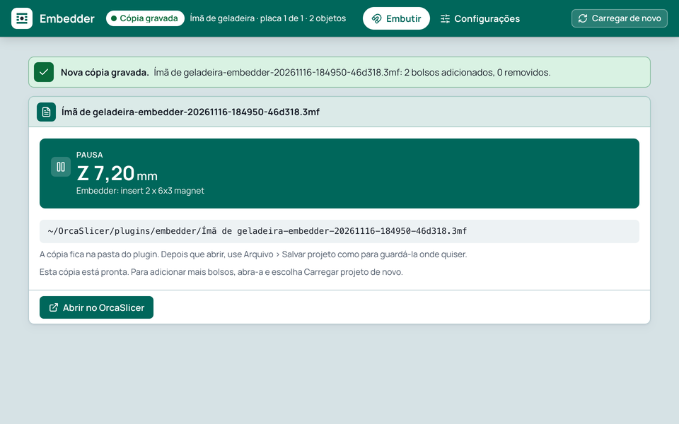
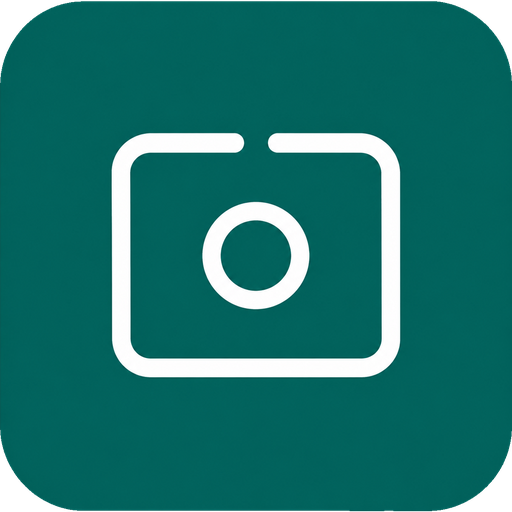

  <picture>
    <source media="(prefers-color-scheme: dark)" srcset="assets/readme/embedder-hero-dark-pt-BR.png">
    
  </picture>

<h1 align="center">🧲 Embedder</h1>

<b>Bolsos para ímãs e NFC, com a pausa na camada certa.</b> Um plugin para o OrcaSlicer · by bloodf

  
  
  
  

  <a href="#-instalação">Instalação</a> · <a href="#-recursos">Recursos</a> · <a href="#-como-usar">Como usar</a> · <a href="#-perguntas-frequentes">Perguntas frequentes</a> · <a href="README.md">English</a>

## ✨ O que faz

O Embedder coloca ímãs e etiquetas NFC dentro das suas peças impressas em 3D. Você escolhe o tamanho do inserto e clica na face da peça onde ele vai, e o Embedder abre um bolso com a folga certa. Quando o bolso fica selado dentro da peça, ele também adiciona uma pausa na camada em que a cavidade está para fechar, e você coloca o inserto antes de a impressora cobri-lo. Ele trabalha numa cópia do projeto, e o original nunca é alterado.

  <picture>
    <source media="(prefers-color-scheme: dark)" srcset="assets/readme/embedder-screen-pockets-dark-pt-BR.png">
    
  </picture>

## 📦 Instalação

Assine o [Embedder no Orca Cloud](https://cloud.orcaslicer.com/p/58222d4f9e52), depois abra **File > Plugins** no OrcaSlicer, clique em **Refresh** e marque **Activate**.

A partir de um arquivo (os menus do OrcaSlicer aparecem aqui com os nomes em inglês):

1. Baixe `embedder_any.whl` da [última versão](https://github.com/bloodf/embedder/releases/latest).
2. No OrcaSlicer, abra **File > Plugins > Install local plugin** e escolha o arquivo.
3. Marque **Activate** e permita a thread em segundo plano quando o OrcaSlicer pedir.
4. Abra a aba **Embedder**, ao lado de Prepare, Preview e Device.

O Embedder é um projeto independente, que não é feito nem mantido pela equipe do OrcaSlicer. Os créditos do código e das fontes em que ele se apoia estão no [NOTICE.md](NOTICE.md).

| Requisito | Detalhe |
|---|---|
| OrcaSlicer | 2.5.0 ou mais novo |
| Perfil da impressora | Um G-code de pausa (`machine_pause_gcode`) para bolsos embutidos. A maioria dos perfis tem. Bolsos abertos não precisam. |
| Pacotes Python | Nenhum |
| Rede | Nenhuma |

## 🧰 Recursos

<table>
  <tr>
    <td width="50%" valign="top">
      
      
<b>Clique onde ele vai</b> Gire a peça na visualização 3D e clique numa face. O bolso aparece ali antes de qualquer coisa ser gravada.

    </td>
    <td width="50%" valign="top">
      
      
<b>Tamanhos de ímã prontos</b> 15 ímãs em disco, de 3x1 a 20x3 mm, e 4 ímãs em bloco, com folga que você ajusta para a sua impressora.

    </td>
  </tr>
  <tr>
    <td width="50%" valign="top">
      
      
<b>Etiquetas NFC também</b> 7 adesivos redondos de 10 a 38 mm, 2 moedas e um cartão, sob uma cobertura de 0,6 mm por padrão.

    </td>
    <td width="50%" valign="top">
      
      
<b>Pausa na camada certa</b> A pausa por camada do próprio OrcaSlicer, na primeira camada acima da cavidade. Ela aparece no controle de camadas.

    </td>
  </tr>
</table>

| | Recurso | O que você ganha |
|---|---|---|
| | Bolsos embutidos | Uma cavidade selada sob uma cobertura (1,0 mm para ímãs e 0,6 mm para NFC, por padrão) em faces planas e em faces laterais verticais. A impressão pausa uma camada antes de a cavidade fechar. |
| | Bolsos abertos | Um bolso aberto em qualquer face, inclusive as inclinadas, para encaixar o inserto depois de imprimir. Sem pausa. |
| | Formatos com respiro | Um disco fica num hexágono, e um bloco numa caixa com um respiro redondo de 1 mm em cada canto. O ar e a cola que sobra saem, e o inserto desce até o fundo. |
| | Escolha o formato | Círculo, hexágono, quadrado ou retângulo, cada um o menor que segura o inserto. A escolha fica guardada para a predefinição. |
| | Fendas em faces laterais | Atrás de uma parede vertical, o inserto fica de pé numa fenda vertical e entra por cima. |
| | Centralizar na face | Leva o bolso ao meio da face plana clicada, que é o que uma tampa, uma base ou um azulejo pedem. |
| | Seus tamanhos | Qualquer disco ou bloco, salvo com um nome e mantido entre as sessões. |
| | Insertos para deixar à mão | Abaixo da lista de bolsos, por exemplo "2 x 6x3 magnet, 1 x 25 mm NFC sticker", com as alturas em que a impressão vai pausar. Cada cópia do objeto conta. |
| | Pausas compartilhadas | Bolsos que terminam na mesma altura dividem uma pausa. |
| | Avisos ao posicionar | Cobertura fina, bolso que sai da peça, etiqueta NFC a menos de 10 mm de um ímã ou um G-code seu já na camada da pausa. |
| | Cópia segura | **Aplicar** grava um novo arquivo de projeto e o abre. O seu projeto nunca é gravado. |
| | Remover ou reaplicar | Os bolsos e as pausas do Embedder são marcados. Carregue o projeto de novo e eles aparecem na lista, prontos para remover. |
| | Pasta em ordem | Depois de cada **Aplicar**, as cópias além das 10 mais recentes ou com mais de 30 dias são apagadas. |

Tamanhos prontos, em mm:

| Inserto | Tamanhos |
|---|---|
| Ímãs em disco, diâmetro x espessura | 3x1, 4x2, 5x1, 5x2, 5x3, 6x2, 6x3, 8x2, 8x3, 10x2, 10x3, 10x5, 12x3, 15x3, 20x3 |
| Ímãs em bloco, comprimento x largura x espessura | 10x5x2, 10x5x3, 20x10x2, 20x10x5 |
| Adesivos NFC redondos, diâmetro (0,4 mm de profundidade) | 10, 13, 20, 22, 25, 30, 38 |
| Moedas NFC | 25x1, 30x2 |
| Cartão NFC | 85,6 x 54 x 0,9 |
| Porcas sextavadas, entre faces x espessura (bolso hexagonal) | M3 5,5x2,4, M4 7x3,2, M5 8x4, M6 10x5 |
| Porcas quadradas, lado x espessura | M3 5,5x2,4, M4 7x3,2, M5 8x4 |

As regras completas dos formatos de bolso, da pausa, dos avisos e dos limites estão em [docs/pockets.md](docs/pockets.md) (em inglês).

## 🛠️ Como usar

1. Abra o projeto no OrcaSlicer e escolha a mesa com a peça.
2. Abra a aba **Embedder** e clique em **Carregar projeto**.
3. Em **Inserto**, escolha um tamanho da lista, ou marque **Tamanho personalizado** e informe o seu. Em **Bolso**, escolha **Embutido** ou **Aberto**.
4. Gire a peça e clique na face onde o inserto vai. Marque **Centralizar na face** para levá-lo ao meio. **Este bolso** mostra o tamanho, a cavidade, a pausa e a cobertura.
5. Clique em **Adicionar bolso**. Adicione outros do mesmo jeito.
6. Clique em **Aplicar** e depois em **Abrir no OrcaSlicer**. No novo projeto, use **Arquivo > Salvar projeto como** para guardá-lo.
7. Fatie. Na pré-visualização, a pausa aparece no controle de camadas logo acima de cada bolso embutido.
8. Comece a impressão. Quando ela pausar, coloque o inserto e retome.

  <picture>
    <source media="(prefers-color-scheme: dark)" srcset="assets/readme/embedder-screen-applied-dark-pt-BR.png">
    
  </picture>

Para mover um bolso, arraste-o na vista 3D: ele desliza pela superfície e acompanha a face embaixo dele. Clique em um bolso, ou na linha dele em **Bolsos a adicionar**, para selecioná-lo. O formulário passa a alterar esse bolso no lugar (tamanho, tipo, rotação, cobertura), as setas o movem 0,5 mm pela face (5 mm com Shift), R o gira 15° e Delete o remove. Um bolso que um Aplicar anterior já gravou fica onde está: marque-o para remoção e coloque-o de novo.

Um **Aplicar** por carga: para mudar os bolsos depois, abra o novo projeto, clique em **Carregar projeto** de novo e reaplique.

## 🔒 Privacidade e segurança

| | O quê e onde |
|---|---|
| Lê | A cópia da mesa atual que o OrcaSlicer exporta para a pasta do plugin e seis valores do perfil ativo: altura de camada, altura da primeira camada, G-code de pausa, sequência de impressão, camadas de raft e área de impressão. |
| Grava | Novas cópias `.3mf` e o `settings.json`, os dois na própria pasta do plugin. Nunca o projeto que você abriu. |
| Envia | Nada. O Embedder não usa a rede e não tem serviço em nuvem nem telemetria. |
| Impressora | Nenhum comando. A pausa é a pausa por camada do próprio OrcaSlicer, que executa o G-code de pausa do seu perfil. O Embedder nunca escolhe M600 nem outro comando por conta própria. |

Uma cópia aplicada contém o projeto inteiro, então cuide dela como do original. Um ímã pode pular para um bico de aço ou para o cabeçote: coloque-o com o lado certo para cima e olhe antes de retomar. Mais em [SECURITY.md](SECURITY.md) (em inglês).

## ❓ Perguntas frequentes

Por que Aplicar abre um projeto novo em vez de alterar o meu?

Os plugins do OrcaSlicer 2.5 não conseguem ler nem alterar a geometria do projeto aberto, e não desenham na visualização 3D do OrcaSlicer. Por isso o Embedder pede ao OrcaSlicer uma cópia da mesa atual, grava cada bolso como uma peça negativa e cada pausa num arquivo novo ao lado dela, e pede ao OrcaSlicer que abra esse arquivo. Use **Arquivo > Salvar projeto como** para guardá-lo.

Embutido está desativado na minha mesa. Por quê?

O Embedder mostra o motivo. Bolsos embutidos são bloqueados quando a sequência de impressão é "Por objeto" (o OrcaSlicer ignora pausas por camada nesse caso), quando o perfil da impressora não tem G-code de pausa, quando o projeto imprime um raft, quando o objeto tem altura de camada variável ou por faixa, quando há cópias do objeto em outra mesa, ou quando a face está inclinada. Eles também são recusados quando o bolso passaria abaixo da mesa, ficaria sem camada impressa embaixo, ou quando a pausa viria antes da segunda camada. Bolsos abertos continuam funcionando.

A impressão não pausou.

Confira três coisas. A sequência de impressão precisa ser "Por camada". O perfil da impressora precisa ter um G-code de pausa. E, se você mudou a altura de camada depois de Aplicar, as camadas mudaram de lugar: carregue o novo projeto de novo e reaplique. Quando um G-code seu já está na camada da pausa, o Embedder o mantém e não adiciona pausa ali; ele avisa assim que você posiciona o bolso.

Por que o bolso é um hexágono?

O hexágono tem, entre os lados planos, a mesma largura que um bolso redondo teria. Os seis lados seguram o disco, e os seis cantos ficam abertos para o ar e a cola que sobra. Um bloco ganha uma caixa com um respiro redondo de 1 mm em cada canto pelo mesmo motivo. A aba mostra os dois tamanhos: o do encaixe e a largura do bolso com os cantos ou os respiros. Um bolso adicionado por uma versão anterior à 0.3.0 mantém o formato até você removê-lo e adicioná-lo de novo. Prefere um furo redondo, um quadrado ou um retângulo? Escolha em **Formato do bolso**.

Posso mudar os bolsos depois de Aplicar?

Pode, na nova cópia. Abra-a, clique em **Carregar projeto** de novo, e o Embedder lista os bolsos e as pausas que ele criou (os nomes começam com "Embedder"). Marque os que quer remover e adicione outros. Bolsos e pausas feitos à mão não são tocados.

Meu objeto tem várias cópias. Cada uma ganha um bolso?

Ganha. Uma peça negativa corta todas as cópias, e a lista de insertos conta cada uma. Quando as cópias diferem por mais do que uma rotação em Z e um deslocamento, nenhum bolso é oferecido.

Aplicar parou com "object not found where expected".

Era um erro com projetos salvos pelo OrcaSlicer 2.5.1, corrigido no Embedder 0.2.1. Atualize o plugin.

O Embedder diz que meu projeto não tem lista de peças.

Objetos cortados com conectores, objetos de malha pura sem lista de peças e arquivos 3MF feitos à mão sem a lista de peças do OrcaSlicer (`model_settings.config`) não são aceitos. O Embedder avisa quando você clica, antes de gravar qualquer coisa. Salvar o projeto pelo OrcaSlicer uma vez adiciona a lista.

Para onde vão as cópias? Elas se acumulam?

Cada Aplicar grava uma nova cópia na pasta do plugin. O Embedder sempre mantém a cópia mais nova de cada projeto e todas as gravadas desde que o OrcaSlicer foi aberto, porque o OrcaSlicer pode estar com elas abertas. Depois de cada Aplicar, ele apaga as cópias além das 10 mais recentes e as com mais de 30 dias. **Configurações > Cópias antigas do projeto** mostra quantas podem sair e quanto espaço ocupam, e **Apagar cópias antigas** apaga todas de uma vez, depois de perguntar. Arquivos que você mesmo pôs na pasta nunca são tocados.

No Linux, Abrir no OrcaSlicer abre uma segunda janela.

No Linux o botão inicia o executável do OrcaSlicer (ou o AppImage) com o arquivo, o que pode abrir uma segunda janela em vez de usar a que já está aberta. Feche a janela antiga, ou abra o arquivo por **Arquivo > Abrir projeto**.

Minha etiqueta NFC não é lida.

Um ímã perto da etiqueta pode impedir a leitura. O Embedder avisa quando um bolso de NFC fica a menos de 10 mm de um bolso de ímã. Uma cobertura com menos de duas camadas também gera aviso, porque o inserto pode aparecer.

## 🌍 Idiomas

Inglês, português do Brasil, espanhol, alemão, chinês simplificado e polonês. O Embedder segue o idioma do OrcaSlicer, ou o que você escolher em **Configurações > Idioma**.

## 🧩 Mais plugins do bloodf

| | Plugin | O que faz | |
|:-:|---|---|---|
|  | 🧩 [Organizer](https://github.com/bloodf/orca_organizer) | Organize as peças pelo contorno real e encha a mesa com mais cópias. | [Instalar](https://cloud.orcaslicer.com/p/5bf381fd42d4) |
|  | 🧲 **Embedder** · você está aqui | Bolsos para ímãs e NFC, com a pausa na camada certa. | |
|  | 💰 [Print Calculator](https://github.com/bloodf/orca_print_calculator) | Preço de cada mesa: filamento, energia, mão de obra, taxas e margem. | [Instalar](https://cloud.orcaslicer.com/p/521c07cf6de2) |
|  | 🧵 [Spooler](https://github.com/bloodf/spooler) | Seu estoque do Spoolman dentro do OrcaSlicer, com o que resta em cada bobina. | [Instalar](https://cloud.orcaslicer.com/p/50c35dcbd6f3) |
|  | 🟣 [Kobra Control](https://github.com/bloodf/kobracontrol) | Controle a Anycubic Kobra X pelo OrcaSlicer na sua rede. | [Instalar](https://cloud.orcaslicer.com/p/59c786285255) |
|  | 🔵 [U1 Control](https://github.com/bloodf/u1control) | Controle a Snapmaker U1 pelo OrcaSlicer: cabeças, câmera, arquivos. | [Instalar](https://cloud.orcaslicer.com/p/55b8c347d443) |

Cada plugin funciona sozinho; instalados juntos, compartilham dados onde ajuda.

## 🤝 Contribuir

Relatos de problemas, projetos que não carregam e pull requests são bem-vindos: comece pelo [CONTRIBUTING.md](CONTRIBUTING.md) e abra uma [issue](https://github.com/bloodf/embedder/issues). O material para desenvolvedores está em [docs/](docs), em inglês: [bolsos, pausas e limites](docs/pockets.md), [arquitetura](docs/architecture.md), [notas sobre o 3MF](docs/3mf.md), [como publicar](docs/release.md) e a [descrição do Orca Cloud](docs/orca-cloud-description.md). Veja também o [changelog](CHANGELOG.md), o [código de conduta](CODE_OF_CONDUCT.md) e o [SECURITY.md](SECURITY.md).

## 📄 Licença

GPL-3.0-only. Veja o [LICENSE](LICENSE).

by bloodf

