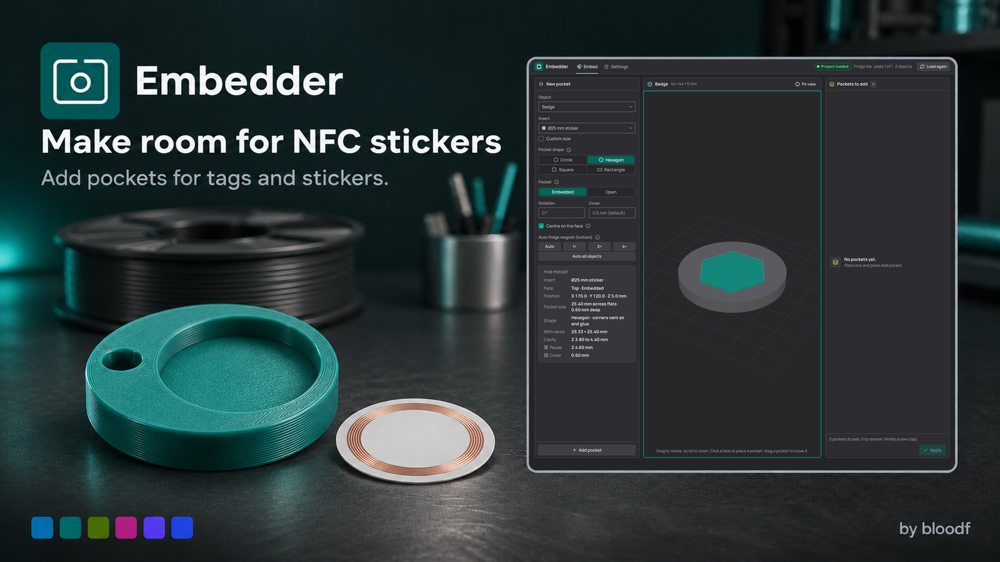
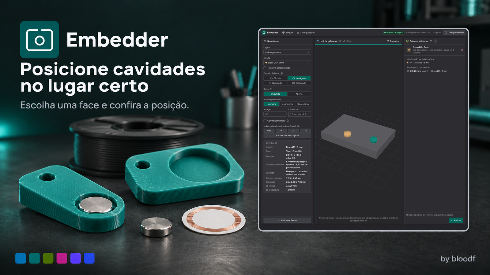
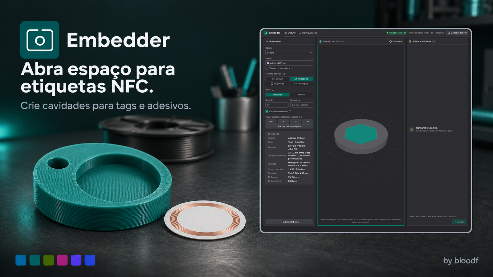

# Orca Cloud description

The text of the Embedder listing on Orca Cloud, in English and Brazilian Portuguese. Paste the block for the listing's
language as it is; each one is under 4000 characters (3152 and 3290). The images are the four store feature
images on `main`, so they show once the commit that adds them is merged. The line for each plugin of the set is the same
in all six repositories; keep it in step with the README's "More plugins by bloodf" table.

## English

```markdown
Embedder puts magnets and NFC stickers inside your prints. Pick an insert size, click the face where it goes, and the print pauses when it is time to drop the insert in.

## What you need

- OrcaSlicer 2.5.0 or newer.
- For pockets sealed inside the print, a printer profile with a pause G-code. Most have one.
- Sealed pockets are blocked for print sequence "By object", rafts and variable layer height. Open pockets always work.

## What it does

Rotate the part in the 3D view and click a face. The pocket shows there before anything is written.

{align=center}

15 disc magnets from 3x1 to 20x3 mm and 4 block magnets are built in, and you can save your own sizes.

{align=center}

NFC stickers from 10 to 38 mm, two coin tags and a card go under a 0.6 mm cover.

{align=center}

A sealed pocket gets OrcaSlicer's own layer pause on the first layer above the cavity. You see it on the layer slider.

{align=center}

Apply writes a new copy of the project and opens it. Your original is never changed.

## How to start

1. Subscribe, open **File > Plugins**, click **Refresh** and tick **Activate**. Allow the background thread.
2. Open the **Embedder** tab, press **Load project**, pick an insert, click a face and press **Add pocket**.
3. Press **Apply**, slice the new copy and print. When the printer pauses, put the insert in and resume. A magnet can jump to a steel nozzle, so check before you resume.

## Privacy

Embedder does not use the network. It reads the project copy OrcaSlicer exports, writes new files only in its own folder, and sends no commands to the printer.

## Languages

English, Brazilian Portuguese, Spanish, German, Simplified Chinese and Polish.

## More plugins by bloodf

- [Organizer](https://cloud.orcaslicer.com/p/5bf381fd42d4): Arrange parts by their real outline and fill a plate with more copies.
- [Print Calculator](https://cloud.orcaslicer.com/p/521c07cf6de2): Price every plate: filament, energy, labour, fees and margin.
- [Spooler](https://cloud.orcaslicer.com/p/50c35dcbd6f3): Your Spoolman stock inside OrcaSlicer, with what is left on each spool.
- [Kobra Control](https://cloud.orcaslicer.com/p/59c786285255): Run the Anycubic Kobra X from OrcaSlicer over your LAN.
- [U1 Control](https://cloud.orcaslicer.com/p/55b8c347d443): Run the Snapmaker U1 from OrcaSlicer: toolheads, camera, files.

Each plugin works on its own; installed together they share data where it helps.

## Source code

[github.com/bloodf/embedder](https://github.com/bloodf/embedder), GPL-3.0-only. An independent project by bloodf, not made or supported by the OrcaSlicer team.
```

## Português (Brasil)

```markdown
O Embedder coloca ímãs e etiquetas NFC dentro das suas peças. Escolha o tamanho do inserto, clique na face onde ele vai, e a impressão pausa na hora de colocá-lo.

## O que você precisa

- OrcaSlicer 2.5.0 ou mais novo.
- Para bolsos selados dentro da peça, um perfil de impressora com G-code de pausa. A maioria tem.
- Bolsos selados são bloqueados com sequência de impressão "Por objeto", raft e altura de camada variável. Bolsos abertos funcionam sempre.

## O que faz

Gire a peça na visualização 3D e clique numa face. O bolso aparece ali antes de qualquer coisa ser gravada.

{align=center}

15 ímãs em disco, de 3x1 a 20x3 mm, e 4 ímãs em bloco já vêm prontos, e você pode salvar os seus tamanhos.

{align=center}

Adesivos NFC de 10 a 38 mm, duas moedas e um cartão ficam sob uma cobertura de 0,6 mm.

{align=center}

Um bolso selado ganha a pausa por camada do próprio OrcaSlicer, na primeira camada acima da cavidade. Ela aparece no controle de camadas.

{align=center}

Aplicar grava uma nova cópia do projeto e a abre. O original nunca é alterado.

## Como começar

1. Assine, abra **File > Plugins**, clique em **Refresh** e marque **Activate**. Permita a thread em segundo plano.
2. Abra a aba **Embedder**, clique em **Carregar projeto**, escolha um inserto, clique numa face e depois em **Adicionar bolso**.
3. Clique em **Aplicar**, fatie a nova cópia e imprima. Quando a impressora pausar, coloque o inserto e retome. Um ímã pode pular para um bico de aço, então confira antes de retomar.

## Privacidade

O Embedder não usa a rede. Ele lê a cópia do projeto que o OrcaSlicer exporta, grava arquivos novos só na própria pasta e não envia comandos para a impressora.

## Idiomas

Inglês, português do Brasil, espanhol, alemão, chinês simplificado e polonês.

## Mais plugins do bloodf

- [Organizer](https://cloud.orcaslicer.com/p/5bf381fd42d4): Organize as peças pelo contorno real e encha a mesa com mais cópias.
- [Print Calculator](https://cloud.orcaslicer.com/p/521c07cf6de2): Preço de cada mesa: filamento, energia, mão de obra, taxas e margem.
- [Spooler](https://cloud.orcaslicer.com/p/50c35dcbd6f3): Seu estoque do Spoolman dentro do OrcaSlicer, com o que resta em cada bobina.
- [Kobra Control](https://cloud.orcaslicer.com/p/59c786285255): Controle a Anycubic Kobra X pelo OrcaSlicer na sua rede.
- [U1 Control](https://cloud.orcaslicer.com/p/55b8c347d443): Controle a Snapmaker U1 pelo OrcaSlicer: cabeças, câmera, arquivos.

Cada plugin funciona sozinho; instalados juntos, compartilham dados onde ajuda.

## Código-fonte

[github.com/bloodf/embedder](https://github.com/bloodf/embedder), GPL-3.0-only. Um projeto independente do bloodf, que não é feito nem mantido pela equipe do OrcaSlicer.
```
