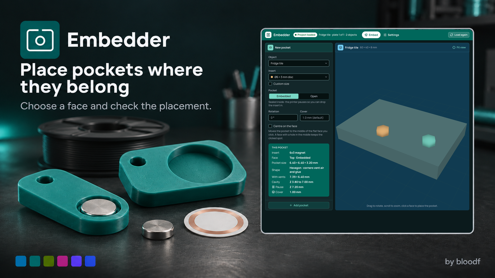
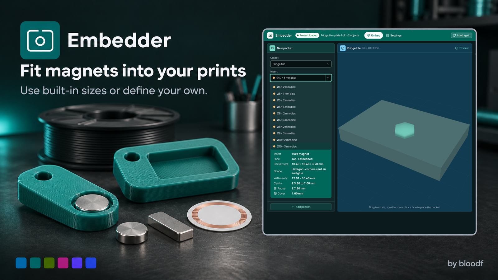
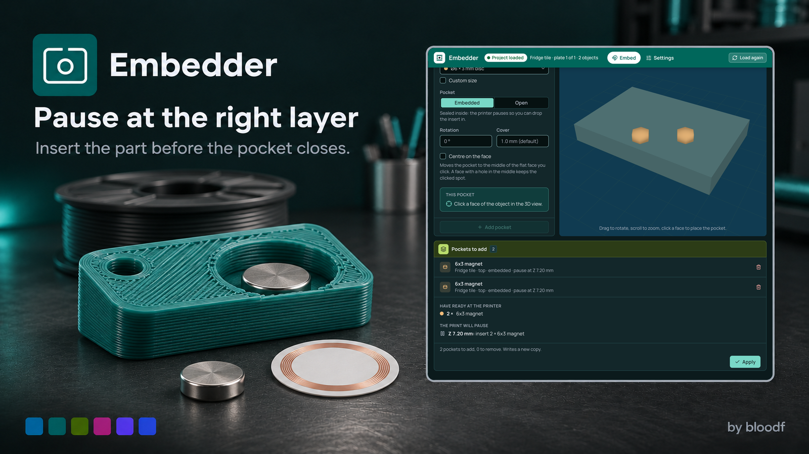

# Orca Cloud description

The text of the Embedder listing on Orca Cloud. The listing is English only: paste the block below as it is (2818
characters, the limit is 4000). It links to [README.md](../README.md) for the full description. The images are the
four store feature images on `main`, so they show once the commit that adds them is merged. The "More plugins by
bloodf" line is the same in all six repositories; keep it in step with the README's table.

```markdown
Embedder puts magnets, NFC stickers and nuts inside your prints. Pick an insert, click the face where it goes, and the print pauses when it is time to drop it in.

Full description: https://github.com/bloodf/embedder/blob/main/README.md

{align=center}

## What it does

- Click a face in the 3D view to place a pocket. It shows there before anything is written.
- Built-in sizes: 15 disc and 4 block magnets, NFC stickers (10 to 38 mm), coin tags and a card, M3 to M6 hex nuts and M3 to M5 square nuts. Save your own sizes too.
- **Fridge magnets on the bottom** stages evenly spaced magnet pockets on the bottom of the selected object, or on every object of the plate with **All objects**.
- Mark a magnet "N up" or "S up". The mark shows in the pocket list and the pause message.
- Sealed pockets get OrcaSlicer's own layer pause just before the cavity closes. Open pockets need no pause.

{align=center}

## Install

Needs OrcaSlicer 2.5.0 or later. Sealed pockets need a printer profile with a pause G-code; most have one.

1. Subscribe on this page.
2. Open **Plugins**. macOS: **File > Plugins** in the menu bar. Windows and Linux: the small ▾ arrow right of **File** at the top-left of the window, then **Plugins**. Click **Refresh**.
3. Tick **Activate** and allow the background thread.

## How to use

1. Open the **Embedder** tab and press **Load project**.
2. Pick an insert, click a face and press **Add pocket**.
3. Press **Apply**, slice the new copy and print. When the printer pauses, put the insert in and resume. A magnet can jump to a steel nozzle, so check before you resume.

{align=center}

Apply writes a new copy of the project and opens it. Your original is never changed.

{align=center}

## Privacy

No network use. It reads the project copy OrcaSlicer exports, writes only to its own folder and sends nothing to the printer.

Languages: English, Brazilian Portuguese, Spanish, German, Simplified Chinese and Polish.

More plugins by bloodf: [Organizer](https://cloud.orcaslicer.com/p/5bf381fd42d4) · [Print Calculator](https://cloud.orcaslicer.com/p/521c07cf6de2) · [Spooler](https://cloud.orcaslicer.com/p/50c35dcbd6f3) · [Kobra Control](https://cloud.orcaslicer.com/p/59c786285255) · [U1 Control](https://cloud.orcaslicer.com/p/55b8c347d443)
```
