# Magnet and NFC pockets for OrcaSlicer

{align=center}

Embedder puts magnets and NFC stickers inside your prints. Pick an insert size, click the face of the part
where it goes, and Embedder cuts a pocket with the right clearance. For a pocket sealed inside the print, it
adds a pause at the layer where the cavity is about to close, so the printer stops, you drop the insert in, and
the print covers it. It works on a copy of your project. Your original is never changed.

## Click where it goes

{align=center}

The Embedder tab shows the parts on your current plate in 3D. Rotate the part and click a face. The pocket
appears in the view before anything is written.

## Magnet sizes built in

{align=center}

Fifteen disc magnets (3x1 up to 20x3 mm) and four block magnets, with XY and Z clearance you can tune for your
printer.

## NFC stickers too

{align=center}

Round stickers from 10 to 38 mm, two coin tags and a card, under a thin cover (0.6 mm by default). Embedder
warns when an NFC pocket is close to a magnet.

## Pause at the right layer

{align=center}

Embedded pockets get OrcaSlicer's own layer pause on the first layer above the cavity. You see it on the layer
slider, and the printer runs your profile's pause G-code. Open pockets, for press-fit after printing, need no
pause and work on any face.

## Your own sizes

{align=center}

Enter any disc or block size and save it as a preset.

## Good to know

- OrcaSlicer 2.5 plugins cannot edit the open project. Embedder writes a new project copy and opens it. Use
  Save As to keep it.
- Embedded pockets need a printer profile with pause G-code, and are blocked for print sequence "by object",
  rafts and variable layer height. Open pockets always work.
- A magnet can jump to a steel nozzle. Put it in the right way up and check before you resume.
- If you change the layer height after applying, load the new project again and re-apply.

## Install

1. Subscribe, then open **File > Plugins**, click **Refresh** and tick **Activate**. Allow the background
   thread.
2. Open the **Embedder** tab next to Prepare and Preview, and load your project.
3. Pick a magnet or NFC size and click a face.
4. Press **Apply**, slice the new copy, and print. The printer pauses for each insert.

Requires OrcaSlicer 2.5.0 or newer. Independent project, not made or supported by the OrcaSlicer team.

Source, documentation and issues: [github.com/bloodf/embedder](https://github.com/bloodf/embedder)
· License: GPL-3.0-only

## More plugins for your OrcaSlicer workflow

- **[Organizer](https://cloud.orcaslicer.com/app/plugins/shared-plugins/5bae3da1-7fcc-4cbd-ae25-53678e392d54)**: Arrange objects by their real outline and fill a build plate with more copies.
- **[Orca Print Calculator](https://cloud.orcaslicer.com/app/plugins/shared-plugins/5f807b01-bfb8-4ad4-a77d-e85e337e4c7f)**: Price every build plate: Spoolman filament cost, energy, labor, fees and a suggested selling price.
- **[Spooler](https://cloud.orcaslicer.com/app/plugins/shared-plugins/5c523246-d53c-44bc-a129-fe2470da6368)**: Your Spoolman spools and filament presets in OrcaSlicer, with what is left on each spool.
- **[U1 Control](https://github.com/bloodf/u1control)**: The Snapmaker U1 in OrcaSlicer: print setup, camera, toolheads, RFID, Spoolman and a file manager.
- **[Kobra Control](https://github.com/bloodf/kobracontrol)**: The Anycubic Kobra X in OrcaSlicer: Print and Send, the Device tab, ACE slots and a dashboard.

Each plugin works on its own; installed together they share data where it helps.
