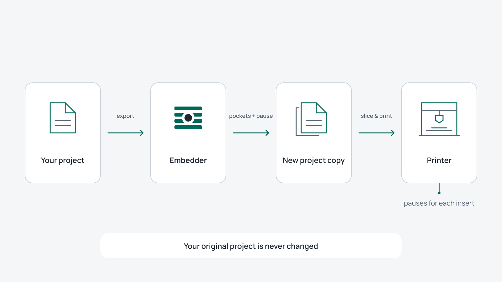
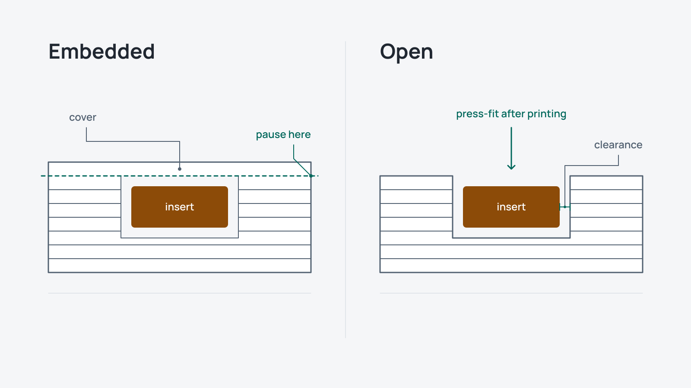

# Pockets, pauses and limits

The reference for what Embedder cuts, where it puts the pause, and when it refuses or warns. The short version is in
the [README](../README.md).

## How it works

<picture>
  <source media="(prefers-color-scheme: dark)" srcset="../assets/diagrams/how-it-works-dark.png">
  
</picture>

OrcaSlicer 2.5 plugins cannot read or change the geometry of the open project, and they cannot draw
in Orca's 3D view. So Embedder does the work on a file:

1. **Load project** asks OrcaSlicer to export a copy of the open project (the current plate) into the
   plugin's storage folder. Embedder reads that copy and shows the parts in its own 3D view.
2. You pick an insert and click a face. Embedder works out the pocket and shows it on the part.
3. **Apply** writes a new project file next to the copy, with each pocket added as a negative part
   and, for embedded pockets, a pause on the layer slider. Then it asks OrcaSlicer to open that file.

The file that opens is a new project. To keep it, use **Save As**. The project you started from is
not touched. If you want to keep working on the new file, do it there; to change the pockets,
load that project again and re-apply.

## Click a face, pick a size

The Embedder tab has a 3D view of the objects on the current plate. Rotate the part, choose an
insert and a pocket type, and click the face. The pocket appears in the view before anything is
written. Clearance and cover thickness are settings you can tune for your printer.

Tick **Centre on the face** to put the pocket in the middle of the flat face you click instead of at the
exact spot, which is what you want for a lid, a base or a tile. The middle is taken over the whole flat
face around the click; when that middle falls outside the face (a ring, a U shape), the clicked spot is
kept.

Below the list of pockets, Embedder shows the inserts to have ready before you print, for example
"2 x 6x3 magnet, 1 x 25 mm NFC sticker". Open pockets count too, and so does every copy of an object.

## Embedded and open pockets

<picture>
  <source media="(prefers-color-scheme: dark)" srcset="../assets/diagrams/pocket-types-dark.png">
  
</picture>

| | Embedded | Open |
|---|---|---|
| Where | flat faces (top or bottom) and upright side faces | any face, including tilted ones |
| Shape | a vertical cavity, closed by the print itself | the picked shape, cut into the surface |
| Pause | yes, one layer before the cavity closes | none |
| Fit | the insert is dropped in during the pause and sealed in | pressed in after printing |

- **Embedded on a flat face:** the picked shape (by default a hexagon for a disc, a rectangle for a block). The pocket
  sits under a cover of material (1.0 mm for magnets, 0.6 mm for NFC by default).
- **Embedded on a side face:** the insert stands on edge behind the wall, in a vertical slot
  (diameter by thickness by diameter for a disc), and is dropped in from above.
- **Open:** cut along the inward direction of the face, flush with the surface.

Every pocket lets air and spare glue out, so the insert goes all the way down:

- **A disc sits in a hexagon.** It is as wide across the flats as a round pocket would be, so the six
  flats hold the disc and the six corners stay open.
- **A block sits in a box with a 1 mm round vent on each corner.** The box itself is the size of the
  block plus the clearance.
- **A side slot has the same corner vents.** The two next to the wall open along the wall only, so the
  wall keeps the thickness you asked for.

The tab shows both sizes: the fit, and how wide the pocket is with its corners or vents. A pocket added by
an older version keeps its shape until you remove it and add it again.

## Pick the pocket shape

**Pocket shape** in the form offers a circle, a hexagon, a square and a rectangle. The insert sets the default (a
disc gets a hexagon, a block a rectangle, as above); pick another and Embedder keeps it for that preset, so it comes
back the next time you choose the preset. A custom size uses the shape you pick for as long as it is in the form.

Each shape is the smallest of its kind that holds the insert with the XY clearance (0.2 mm by default) on every side:

| Shape | Measured | Round insert (diameter d) | Block (l x w) | Vents |
|---|---|---|---|---|
| Circle | diameter | d + 2 x clearance | the block's diagonal, (l + 2c) by (w + 2c) | none |
| Hexagon | across the flats | d + 2 x clearance: the six flats hold the disc | wide enough that the block's corners touch two slanted flats: the larger of w + 2c and (sqrt(3) (l + 2c) + w + 2c) / 2 | the six corners |
| Square | side | d + 2 x clearance | the longer side plus clearance | a 1 mm round vent on each corner |
| Rectangle | width x length | d + 2 x clearance each way (a square) | (l + 2c) x (w + 2c) | a 1 mm round vent on each corner |

A hexagon is the default for a round insert because it fits it exactly as a round pocket would, and its corners
let air and glue out. Pick the circle for a clean round hole; nothing vents it.

The plan shows the size in the shape's own terms ("Ø6.40 mm", "6.40 mm across flats", "6.40 mm sides" or
"10.40 x 5.40 mm") and the depth. **Rotation** turns every shape about the pocket's axis; a hexagon starts with two
corners along X. On an upright side face an embedded insert stands on edge in its slot whatever the shape.

## The pause

For an embedded pocket the cavity floor and top are snapped to the layer grid, and the pause goes on
the first layer above the cavity top, so it runs just before the cover starts. Pockets that end at the
same height share one pause. The pause is OrcaSlicer's own per-layer pause: you see it on the layer
slider in the preview, and the printer runs the profile's pause G-code (`machine_pause_gcode`). Embedder
never picks M600 or any other command itself.

## Built-in insert presets

- **Disc magnets** (diameter x thickness, mm): 3x1, 4x2, 5x1, 5x2, 5x3, 6x2, 6x3, 8x2, 8x3, 10x2,
  10x3, 10x5, 12x3, 15x3, 20x3
- **Block magnets** (length x width x thickness, mm): 10x5x2, 10x5x3, 20x10x2, 20x10x5
- **Round NFC stickers** (diameter, 0.4 mm deep): 10, 13, 20, 22, 25, 30, 38 mm
- **NFC coins:** 25x1 and 30x2 mm
- **NFC card:** 85.6 x 54 x 0.9 mm
- **Your own:** any disc or block, saved by name and kept between sessions

## Warnings and limits

Embedded pockets are blocked, with the reason shown, when:

- the print sequence is "by object" (OrcaSlicer ignores layer pauses in that mode)
- the printer profile has no pause G-code
- the profile uses a raft, or the object has variable layer height or layer ranges
- copies of the object sit on another plate (the pause is written for one plate)
- the face is tilted (open pockets still work there)
- the pocket would reach below the bed, would have no printed layer under it, or the pause would fall
  before the second layer

When the object's copies differ by more than a Z rotation and a move, no pocket is offered at all: one
negative part cuts every copy.

Embedder warns, without blocking, when the cover is thin (less than two layers, or under 0.8 mm for a
side wall), when the pocket reaches outside the part, when an NFC pocket is within 10 mm of a magnet
pocket (the tag may not read), and when another custom G-code already sits on the pause layer (Embedder
leaves it alone and adds no pause there). That last warning shows as soon as you place the pocket, not only
after Apply.

Things to know:

- **Magnets can jump.** A magnet may snap to a steel nozzle or the print head. Put each magnet in with
  the right side up (check the pole before you place it), and look before you resume the print.
- **Changing the layer height after Apply moves the layers.** The pause is tied to a height. If you
  change the layer height in the new project, load it again and re-apply.
- **Cut objects with connectors** and **bare mesh objects** without a parts list are not supported, and
  neither is a hand-made 3MF without OrcaSlicer's part list (`model_settings.config`). Embedder says so when
  you click, before anything is written. Save the project from OrcaSlicer once to add the part list.
- **Old copies are cleaned up.** Each Apply writes a new copy into the plugin folder. Embedder always keeps
  the newest copy of each project and every copy written since OrcaSlicer started, since OrcaSlicer may
  have those open. After each Apply it deletes older copies beyond the 10 most recent, and any older than
  30 days. **Settings > Old project copies** shows how many can go and how much space they take, and
  **Clear old copies** deletes them all at once (after asking). Files you put in the folder yourself are
  never touched.
- **One Apply per load.** After Apply the new copy is the project; open it and load it again to add more.
- **Linux:** "Open in OrcaSlicer" starts the OrcaSlicer executable (or the AppImage) with the file, which
  may open a second OrcaSlicer window instead of reusing the running one. Close the old window, or open
  the file from File > Open.
- Embedder's pockets and pauses are marked (the part names start with "Embedder", the pause text with
  "Embedder:"). Loading a project that already has them lists them so you can remove or re-apply them.
  Pockets and pauses you made by hand are left alone.
